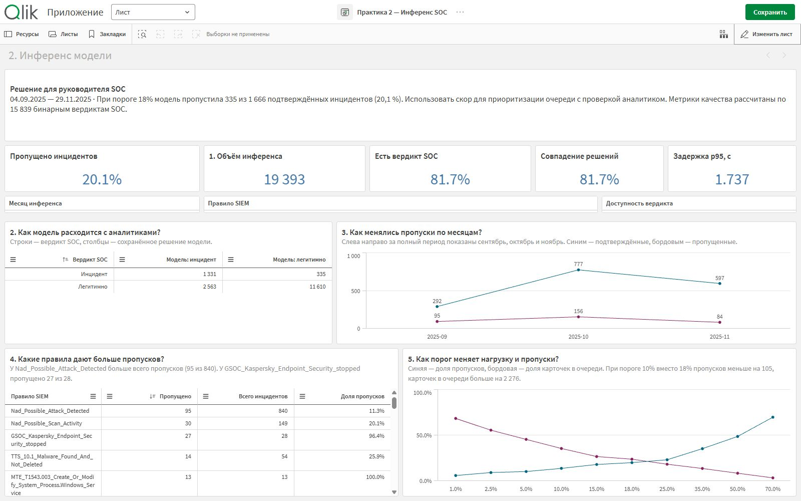

# Практика 2. Инференс модели

При рабочем пороге 18% модель пропустила **335 из 1 666 подтверждённых инцидентов (20,1%)**. По результатам проверки оценку модели можно использовать для приоритизации очереди с проверкой аналитиком.

## Вопросы на листе

| Вопрос                                       | Как показан ответ                                                                                                                                                                                                                               |
| -------------------------------------------- | ----------------------------------------------------------------------------------------------------------------------------------------------------------------------------------------------------------------------------------------------- |
| Каков объём работы модели?                   | Показатели сверху показывают 19 393 прогона, покрытие вердиктами SOC и 95-й процентиль задержки 1,737 с.                                                                                                                                        |
| Как решения расходятся с вердиктами SOC?     | Матрица ошибок показывает четыре исхода. В строке «Инцидент» и столбце «Модель: легитимно» находятся 335 пропусков.                                                                                                                             |
| Как менялись пропуски по месяцам?            | Две линии показывают число подтверждённых инцидентов и число пропусков. В сентябре доля пропусков составила 32,5%, в октябре — 20,1%, в ноябре — 14,1%.                                                                                         |
| На каких правилах SIEM сосредоточены ошибки? | Таблица показывает число пропусков, число подтверждённых инцидентов и долю пропусков по каждому правилу. Например, `Nad_Possible_Attack_Detected` даёт 95 пропусков из 840 инцидентов, а `GSOC_Kaspersky_Endpoint_Security_stopped` — 27 из 28. |
| Какие издержки даёт снижение порога?         | График сценариев сравнивает долю пропущенных инцидентов и долю карточек в очереди за весь период. Сценарий с порогом 10% даёт на 105 пропусков меньше и на 2 276 карточек в очереди больше по сравнению с 18%.                                  |

Чтобы проверить срез, выберите месяц или правило SIEM на листе. Сравнение порогов на графике рассчитано для всего периода.

[Контрольные расчёты](checks.md)
