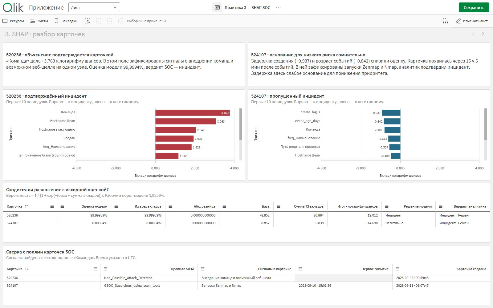

# Практика 3. SHAP

Объяснения модели `lgbm_gate1__v001` проверены на полном продуктивном срезе занятия 3.7. Для сравнения выбраны две карточки с подтверждённым инцидентом и разными решениями модели. Рабочий порог модели — 1,9259%.

## Разбор карточек

- **520236. Объяснение согласуется с данными карточки.** Поле «Команда» внесло +3,763 к логарифму шансов инцидента. В самом поле зафиксированы сигналы о внедрении команд и возможном веб-шелле. Оценка модели около 99,9994%, аналитик подтвердил инцидент.
- **524107. Основание для снижения оценки сомнительно.** Задержка создания карточки и возраст событий снизили логарифм шансов на 0,937 и 0,842 соответственно. В карточке зафиксированы запуски Zenmap и Nmap. Она создана примерно через 15 ч 5 мин после первого события. Модель оценила её примерно в 0,00004% и отнесла к легитимным, аналитик подтвердил инцидент.

Знаковые столбцы показывают силу и направление десяти крупнейших вкладов на общей шкале. Таблица под графиками сопоставляет решение модели, вердикт SOC и проверку суммы всех 73 вкладов. Ниже приведены поля карточек, по которым проверялись объяснения.

## Вклад по потоку

Рейтинг по среднему модулю SHAP показывает, какие признаки сильнее всего меняют оценку. Таблица групп показывает также знак среднего вклада. Фильтры по месяцу, правилу SIEM, вердикту и типу признака позволяют перейти от всего потока к группе карточек.

[Контрольные расчёты](checks.md)
