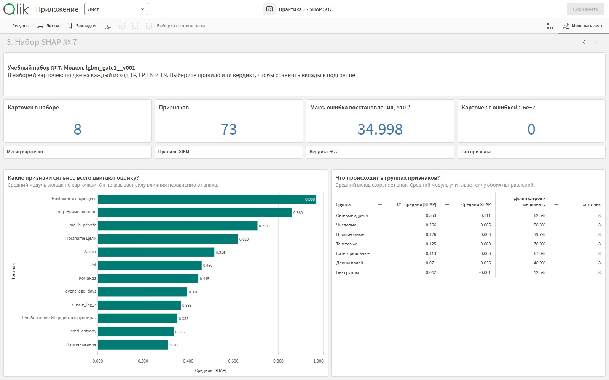

# Практика 3. SHAP

Объяснения модели `lgbm_gate1__v001` проверены на восьми карточках из учебного набора № 7 занятия 3.7. Для подробного разбора выбраны два подтверждённых инцидента с разными решениями модели. Рабочий порог модели составляет 1,9259%.

## Разбор карточек

- **528485. Объяснение согласуется с данными карточки.** Частота наименования, поле узла цели и поле узла источника увеличили логарифм шансов на 1,781, 1,291 и 1,251 соответственно. В карточке указаны внешний источник, внутренняя цель и срабатывание правила `Nad_Possible_Attack_Detected`. Оценка модели составила 74,72077%. Аналитик подтвердил инцидент.
- **527373. Основание для снижения оценки сомнительно.** Длина алерта и задержка создания уменьшили логарифм шансов на 1,129 и 1,003 соответственно. Карточку создали через 17 ч 5 мин после последнего события. Алерт сообщает об отключении Kaspersky Endpoint Security, и аналитик подтвердил инцидент. Оценка 0,00505% оказалась ниже рабочего порога.

Знаковые столбцы показывают силу и направление десяти крупнейших вкладов на общей шкале. Таблица под графиками сопоставляет решение модели, вердикт SOC и проверку суммы всех 73 вкладов. Ниже приведены поля карточек, по которым проверялись объяснения.

## Вклады в наборе № 7

Рейтинг по среднему модулю SHAP показывает, какие признаки сильнее всего меняют оценку в наборе. Таблица показывает также знак среднего вклада по группам признаков. Фильтры по правилу SIEM, вердикту и типу признака позволяют сравнить вклады внутри набора.

[Контрольные расчёты](checks.md)
